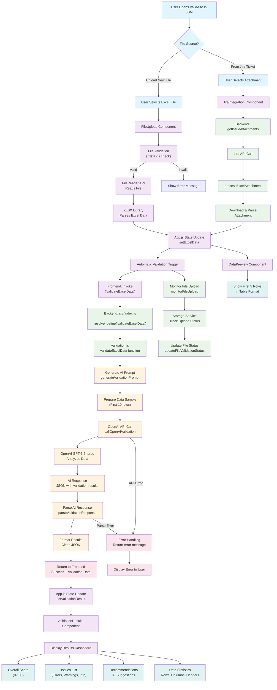
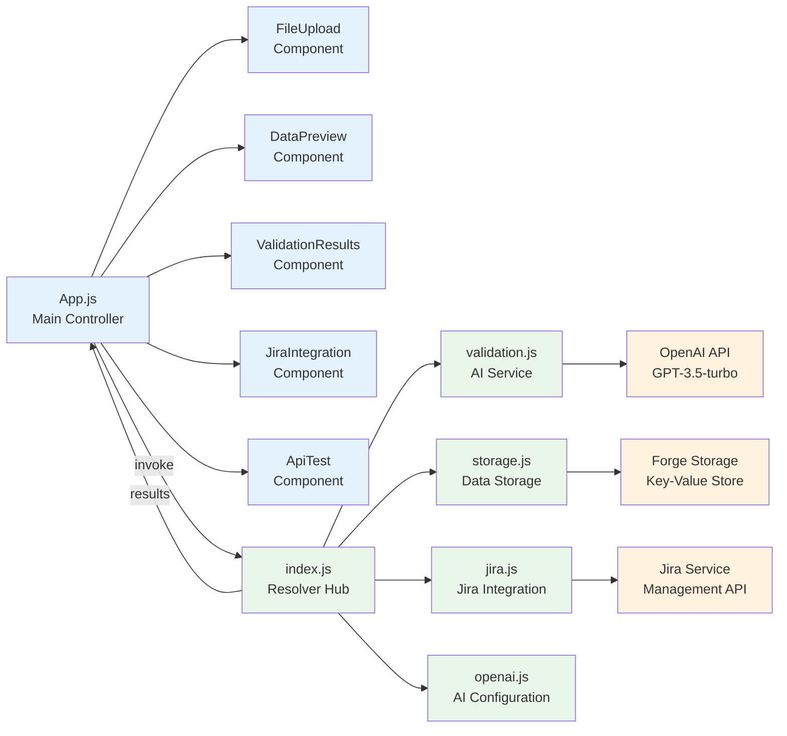
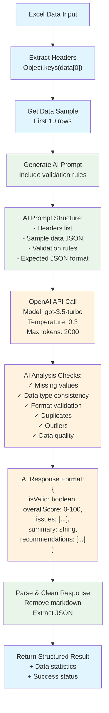
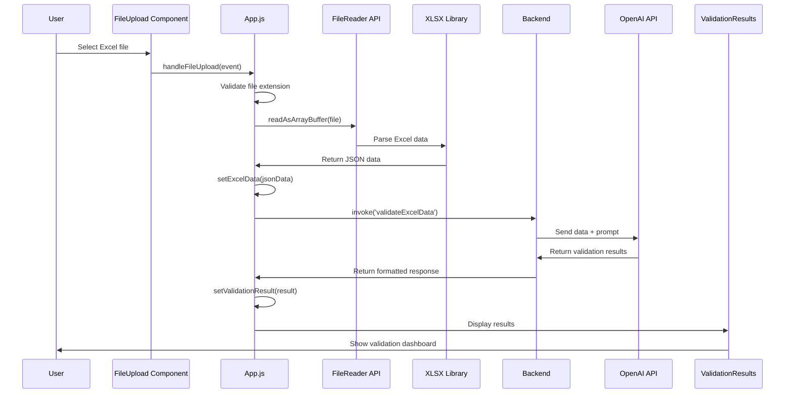
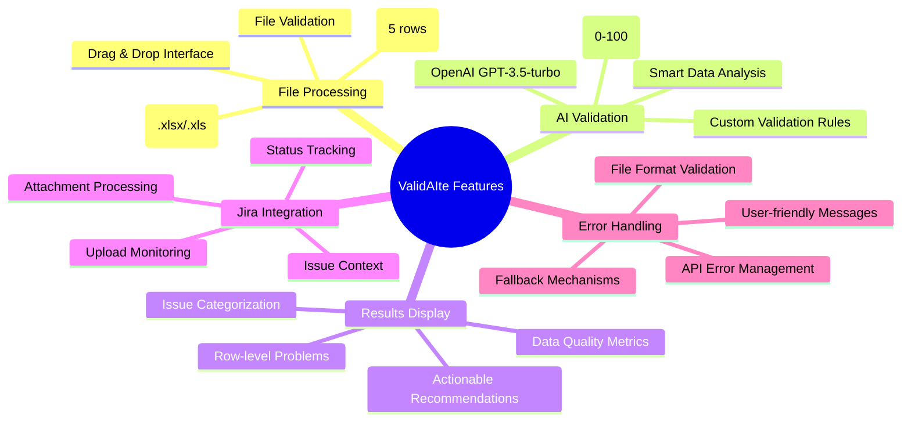

# ValidAIte Architecture Flowchart

## Complete Application Flow

## Component Architecture

## Data Validation Process Detail

## File Upload & Processing Flow

## Key Features Breakdown

This flowchart shows the complete journey from when a user opens the app to when they see the final validation results, including all the technical components working behind the scenes.
